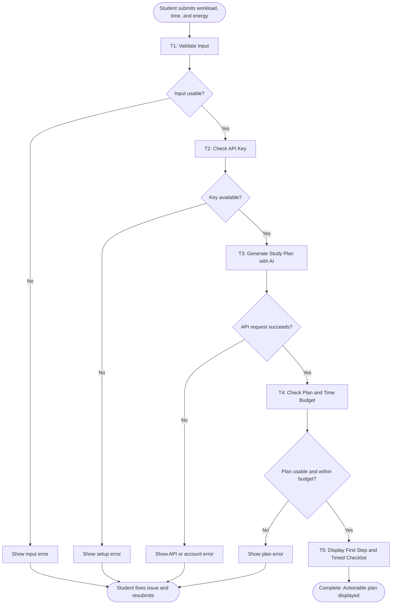

# Workflow of Tasks

## 1. Workflow Goal

NextStep addresses BUS4498 Option 2: helping a student who feels overwhelmed by several study tasks or assignments turn them into manageable next steps. The goal is a short plan that fits the student's available time and makes the first action clear.

## 2. Workflow Trigger

The workflow begins when a student submits their study tasks, any known deadlines or blockers, the minutes available today, and an energy level in the local app.

## 3. Completion Condition at Runtime

One workflow run is successfully completed when the app displays an actionable first step and a timed checklist whose total fits the student's time budget. The result may also include work to do later and one question about missing information. Checking off steps is optional and happens after the plan is generated.

A run that has invalid input, no API key, an API or account error, or an unusable plan has **not** completed successfully. The app shows an error so the student can correct the issue and submit again. It does not automatically retry or save a plan.

## 4. General Workflow

The app first validates that the student provided a task description, a study period from 10 to 480 minutes, and an energy level. The local server then checks for an OpenAI API key. If these checks pass, the running app sends the workload and constraints to the model. The model identifies a practical starting point, breaks larger work into concrete actions, considers stated deadlines and blockers, and sets aside work that will not fit today. If important information is missing, it can ask one clarifying question while still proposing a useful plan.

The server checks that the model returned at least one step, that each duration is usable, and that the total does not exceed the time budget. The browser then displays the first action, timed checklist, later work, and optional question. The student can mark displayed steps complete as they study.

## 5. Workflow Diagram

## 6. Model, Tools, and Skill Decision

The running app uses the OpenAI Responses API with `gpt-6-luna` for the reasoning task in T3. A JSON schema gives the app predictable plan fields. The local Node.js server validates input and output and keeps the API key out of the browser. The browser provides the form and checklist. Codex helped build these pieces; the model called by the running app produces each student's plan.

No reusable Skill is planned for this single workflow. The server instruction and output schema already make the task and response format consistent. The app requires internet, a valid API key, and available API credits for a live plan. Students should check the model's interpretation of deadlines and assignment details before acting.
