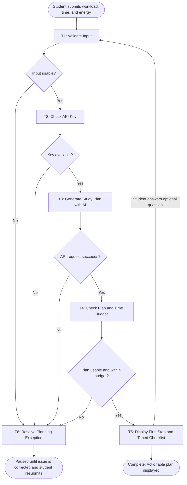

# Workflow of Tasks

## 1. Workflow Goal

This workflow supports the goal in the [NextStep project charter](../../README.md#team-charter). NextStep helps a student turn several overwhelming study tasks into a short plan with a clear first action and timed steps that fit the available study period.

## 2. Workflow Trigger

The workflow begins when a student submits study tasks, any known deadlines or blockers, available minutes, and an energy level in the local app.

## 3. Completion Condition at Runtime

One run completes successfully when the app displays an actionable first step and a timed checklist whose total is within the student's time budget. The result may also show deferred work and one clarifying question. The student can answer the question to generate a revised plan within the same time budget. Marking items complete happens after plan generation and is optional.

Invalid input, an unavailable API key, an API or account error, or an unusable model response are unsuccessful runs. The app displays an error and the student or project operator may correct the issue and resubmit. There is no automatic retry. The current draft, generated plan, and checklist progress are saved in the student's browser.

## 4. General Workflow

T1 checks that the submitted task description, time budget, energy level, and any clarification answer are usable. T2 checks for an API key in the environment or local key file. T3 sends the workload and constraints to the model, which proposes concrete, prioritized actions, a starting step, later work, and an optional clarification. T4 checks that the returned steps have usable durations and fit the submitted time budget. T5 displays the plan and a checklist in the browser. If a question is shown, the student may answer it and return to T1 for a refined plan.

If a check or API request fails, the app shows an error. T6 represents the manual follow-up: revise input, supply a key, resolve account access or credits, or retry after a temporary service problem. The app does not silently substitute a made-up plan.

## 5. Workflow Diagram

See the [task summary](task-summary.md) for each task's specification. The model is responsible for generating the study actions in T3; the other app tasks validate, route, and display the result.

## 6. Model, Tools, and Automation Levels

- **T1, T2, T4, and T5 (Level 1):** JavaScript and Node.js handle input validation, API key checks, output verification, and displaying the plan using predefined rules.
- **T3 (Level 2):** The Claude Messages API provides access to `claude-haiku-5-5`, which converts student workloads into prioritized, timed study steps.
- **T6 (Level 0):** The student or project operator manually resolves errors and resubmits.
- **Level 3 decision:** No Level 3 task is necessary because the workflow follows a predefined sequence. The AI generates recommendations but does not independently choose tools or change the workflow.
- **External tools:** The local browser provides the interface, Node.js runs the server, and the Claude API generates the study plan. No additional integrations are required.
- **Skill decision:** A reusable Skill is unnecessary because this is one focused workflow, and the planning instructions and expected JSON output are already defined in the application.
